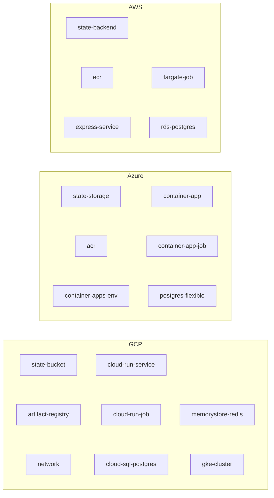

# Reusable multi-cloud Terraform modules

These modules deploy small container apps (an API, a web front end, an optional batch or seed job, and an optional Postgres database) to **Google Cloud, Azure or AWS** with the same shape on each. The app repos call them from `terraform/{gcp,azure,aws}/`, pinned to a git tag:

```hcl
module "api" {
  source = "git::https://github.com/ovokpus/GKE-Cluster-Management.git//terraform/modules/gcp/cloud-run-service?ref=tf-modules-v0.1.0"
  # ...
}
```

Providers: `hashicorp/google ~> 8.9`, `hashicorp/azurerm ~> 5.12`, `hashicorp/aws ~> 6.71`, `hashicorp/random ~> 3.9` (the latest on the Terraform Registry on 2026-10-30). Terraform `>= 1.9`; CI uses 1.17.



| Role | GCP | Azure | AWS |
|---|---|---|---|
| Remote state | `state-bucket` (GCS, versioned) | `state-storage` (Storage account + container, Entra ID auth) | `state-backend` (S3 + optional DynamoDB lock table; S3 native locking also works) |
| Image registry | `artifact-registry` | `acr` (admin user off) | `ecr` (scan on push, immutable tags) |
| Web service | `cloud-run-service` (Cloud Run v2) | `container-app` (Container Apps, in `container-apps-env`) | `express-service` (ECS Express Mode: Fargate + ALB + HTTPS) |
| Batch / seed job | `cloud-run-job` | `container-app-job` (manual trigger) | `fargate-job` (task definition + `run-task` command) |
| Postgres | `cloud-sql-postgres` (private IP, password in Secret Manager) | `postgres-flexible` (Burstable B1ms) | `rds-postgres` (private, encrypted, password in Secrets Manager) |
| Networking | `network` (VPC, subnet, private services access) | default Container Apps networking | default VPC (root module) |
| Extras | `memorystore-redis`, `gke-cluster` | | |

**Why ECS Express Mode and not App Runner.** AWS App Runner stopped accepting new customers on April 30, 2026, and AWS points new users to [ECS Express Mode](https://docs.aws.amazon.com/AmazonECS/latest/developerguide/express-service-overview.html) (`aws_ecs_express_gateway_service`).

**Secrets.** Database passwords are generated with `random_password`, so they are also stored in Terraform state. Keep state in the remote backends above, never in git.

**Cost.** Nothing here is free. Cloud SQL, Postgres Flexible Server, RDS, the ALB behind each ECS Express service and GKE all bill by the hour even when idle. Run `terraform destroy` when you finish.

## CI

`.github/workflows/terraform.yml` runs `terraform fmt -check`, `init -backend=false` and `validate` for every module, then `tflint` (the cloud's ruleset, configs in `.tflint/`) and `checkov` (soft fail). It never runs `plan` or `apply` and needs no cloud credentials.

## Folded in from the GCP lab repos

Useful pieces of these repos (all by Ovo Okpubuluku) were **copied**, not moved. The originals are unchanged.

| From | What | Where now |
|---|---|---|
| [ovokpus/GCP-Terraform-App-Deployment](https://github.com/ovokpus/GCP-Terraform-App-Deployment) | GCS state bucket, GKE cluster + node pool, Artifact Registry, Cloud Run | Reworked into `modules/gcp/state-bucket`, `gke-cluster`, `artifact-registry`, `cloud-run-service`. The original `.tf` files are in `examples/from-labs/GCP-Terraform-App-Deployment/`. |
| [ovokpus/gke-multi-tenant-app](https://github.com/ovokpus/gke-multi-tenant-app) (MIT) | Namespace quotas, developer RBAC role, multi-tenant Terraform playbook | `examples/from-labs/gke-multi-tenant-app/` |
| [ovokpus/valkyrie-app](https://github.com/ovokpus/valkyrie-app) (MIT) | Kubernetes Deployment/Service and the Jenkins CD pipeline for GKE | `examples/from-labs/valkyrie-app/` |
| [ovokpus/GKE-Application-Deployment](https://github.com/ovokpus/GKE-Application-Deployment) | Cloud Build pipelines with dev/prod GKE manifests | `examples/from-labs/GKE-Application-Deployment/` |
| [ovokpus/report-notification-service](https://github.com/ovokpus/report-notification-service) (MIT) | Cloud Run deploy scripts for the Pub/Sub email/SMS services | `examples/from-labs/report-notification-service/` |

The copies in `examples/from-labs/` are kept as they were, for reference. CI does not lint them.
